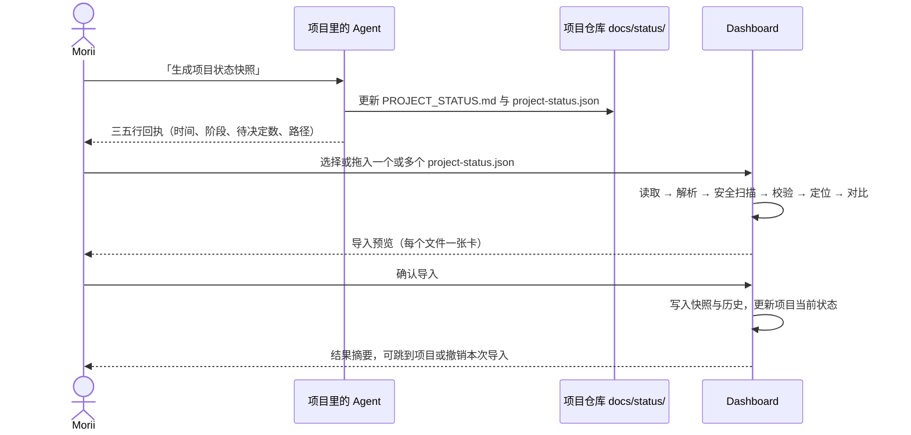

# 04 · 手动导入与历史管理

> 状态：已获批（2026-10-12）。协议本身见 [03](./03-status-protocol-v1.md)，页面布局见 [02](./02-information-architecture-ux.md)。

## 1. 端到端流程



整个过程由 Morii 触发，Dashboard 不主动去任何地方取文件。不需要每天做：哪个项目有了进展，就更新哪个。

## 2. 入口

| 入口 | 位置 | 行为 |
| --- | --- | --- |
| 「导入」按钮 | 顶栏，任何页面都在 | 打开导入对话框，不限定项目 |
| 「导入快照」 | 项目详情页头部 | 打开对话框，预选该项目；文件属于别的项目时报错并给出切换选项 |
| 过期提示里的「更新」 | 概览的报告新鲜度区 | 同上，预选该项目，同时显示「去 Agent 会话里输入：生成项目状态快照」 |
| 首次使用的空状态 | 概览、项目页 | 讲清三步，并给出导入按钮 |
| 快捷键 | `I`（P1） | 同顶栏按钮 |

对话框里还放一个「粘贴 JSON」的次要入口（P1），用于 Agent 在云端会话、不方便拿到文件的情况。

## 3. 处理流水线

每个文件独立走一遍，一个文件出错不影响其他文件。前端先跑一遍给出即时预览，**确认时服务端用同一套代码重跑**，不信任前端的结论。

| 步骤 | 做什么 | 失败时 |
| --- | --- | --- |
| 1 读取 | 限制 1 MiB；判断编码：UTF-8 通过，UTF-8 带 BOM 去掉并提醒，UTF-16 或其他编码报错 | 错误 |
| 2 解析 | `JSON.parse`；失败时换算出行号、列号，截取附近 40 个字符 | 错误 |
| 2a 代码块检测 | 解析失败且内容像 ```` ```json ```` 包裹时，询问是否提取 | 由 Morii 选 |
| 3 安全扫描 | 密钥形态扫描（见 03 第 6.4 节）；命中即停，不回显内容 | 错误 |
| 4 版本 | 读 `schema_version`，选择校验规则 | 错误 |
| 5 Schema 校验 | 收集全部问题，不在第一个错误处停下 | 按接收规则分为错误和提醒 |
| 6 语义校验 | 项目是否登记、里程碑 ID 是否重复、时间是否在未来、跨字段一致性 | 错误或提醒 |
| 7 定位 | 计算内容指纹，查重；与该项目当前最新快照比较时间 | 决定「新的最新 / 进历史 / 重复 / 同时冲突」 |
| 8 对比 | 与当前最新快照做差异 | 只用于预览 |

**内容指纹**：对解析后的对象做规范化序列化（RFC 8785 JSON Canonicalization Scheme：键排序、数字和字符串统一写法），再取 SHA-256。这样，同一份内容即使缩进或键的顺序不同，也会被认出来。另外保存原始字节的 SHA-256，用于核对原文。

## 4. 导入预览

```text
┌ 导入项目快照 ─────────────────────────────────────────────── ✕ ┐
│                                                              │
│  ┌ 把 project-status.json 拖到这里 ─────────────────────────┐   │
│  │   或 [选择文件]   · 可以一次选多个   · [粘贴 JSON]          │   │
│  └──────────────────────────────────────────────────────────┘   │
│                                                              │
│  ✓ MoriMeta  mori.meta                         [展开]        │
│    快照 10月11日 20:14（2 小时前） · 报告来自 [Codex ▾]         │
│    将成为最新快照                                              │
│    阶段 集成中 → 验收中 · 里程碑 2 项有变化 · 新增 1 条待决定      │
│                                                              │
│  ⚠ Enouia Runtime  enouia.runtime              [展开]        │
│    快照 10月11日 17:40 · 报告来自 [Claude ▾]（据分支前缀推断）    │
│    将成为最新快照 · 2 条提醒                                     │
│      · summary 有 171 字，超过 160 字，卡片上会截断               │
│      · 里程碑 activity-b4 声称有仓库证据，但没写证据位置           │
│                                                              │
│  ◷ Moriium 主站  moriium.main                  [展开]        │
│    快照 10月2日 · 比当前最新（10月9日）早，只进入历史               │
│                                                              │
│  = Moriium Gallery  moriium.gallery                         │
│    与 10月9日导入的快照内容相同，不会重复保存                       │
│                                                              │
│  ✕ project-status (1).json                     [查看问题]     │
│    无法导入 · 3 个错误    [复制给 Agent 的修复说明]               │
│                                                              │
│                        [取消]   [导入 3 份快照]                 │
└──────────────────────────────────────────────────────────────┘
```

- 每张卡的状态同时用图标、文字和颜色表达。
- 展开后显示完整差异：阶段、进度、里程碑（新增、移除、状态变化、证据变化、验收变化）、阻塞、下一步、待决定。
- 「报告来自」默认从 `source.branch` 的前缀推断（`claude/` → Claude，`codex/` → Codex），推断不出时为「未注明」。Morii 可以改。文件里有 `reporter`（v1.1）时以它为准，预览中注明来源。
- 导入按钮上的数字只算可导入的文件。全部不可导入时按钮禁用，并说明原因。
- 读屏：校验完成后通过 live region 播报「5 个文件：3 个可导入，1 个重复，1 个有错误」。
- 拖放不是唯一方式，「选择文件」按钮键盘可达。

## 5. 去重、冲突与旧快照

| 情况 | 判断 | 处理 |
| --- | --- | --- |
| 完全重复 | 内容指纹与已有快照相同 | 不保存；显示「已于某日导入」，链接到那份快照 |
| 同一时刻、不同内容 | 同一 `project_id` + 同一 `snapshot_at`（按时刻比较），指纹不同 | Morii 选「替换」或「取消」。替换时旧版标记为被替换，默认不在历史中显示，可展开查看 |
| 较新 | `snapshot_at` 晚于当前最新 | 成为新的当前状态 |
| 较旧 | `snapshot_at` 早于当前最新 | 只插入历史，按时间排到正确位置，不改变当前状态 |
| 同一批里同一项目多份 | — | 按时间排序后依次处理，最晚的那份成为当前状态 |

**「当前状态」的定义**：该项目所有未删除、未被替换的快照中，`snapshot_at` 最晚的一份。与导入先后无关。

**补导历史**：旧快照只在各仓库的 Git 历史里时，可以用 `git show <提交>:docs/status/project-status.json` 导出成文件再导入。Dashboard 会把它们排进历史，不影响当前状态。

## 6. 项目匹配

- 只按 `project_id` 精确匹配登记表，不按名称、文件名或路径猜。
- 未登记：报错，列出已登记 ID，给出「去设置里登记」的链接。不自动建项目。
- 从项目页导入但 ID 不符：报错「你在 MoriMeta 页面导入，但这份文件属于 enouia.memory」，提供「改为导入到 Enouia Memory」。
- `project_name` 与登记名称不一致：只提醒，界面始终用登记名称。

## 7. 错误怎么解释

每条问题固定四部分：**位置 · 问题 · 收到了什么 · 怎么改**。位置用人话写（「milestones 第 3 项 → status」），同时在展开处给出 JSON Pointer（`/milestones/2/status`）。

常见错误的文案草稿：

| 情况 | 文案 |
| --- | --- |
| JSON 语法 | 第 14 行第 5 列附近不是合法的 JSON：`"title": "安装包",}`。常见原因是最后一项后面多了逗号。 |
| 代码块包裹 | 文件像是被 Markdown 代码块包着（以 ```` ```json ```` 开头）。要提取其中的 JSON 再校验吗？ |
| UTF-16 | 文件是 UTF-16 编码。请让 Agent 用 UTF-8（无 BOM）重新写入，PowerShell 的 `Out-File` 默认会写成 UTF-16。 |
| 疑似密钥 | 第 22 行疑似包含访问令牌，已停止处理，内容没有保存。请让 Agent 删掉后重新生成。 |
| 未登记项目 | 项目 ID「mori.metta」没有登记。已登记：moriium.main、moriium.gallery、mori.meta、enouia.memory、enouia.runtime、morii.dashboard。 |
| 时间无时区 | snapshot_at「2026-10-11T20:00:00」没有时区，无法确定是哪个时刻。应写成 2026-10-11T20:00:00+08:00。 |
| 时间在未来 | snapshot_at 比现在晚 3 小时。请检查 Agent 所在机器的时间或时区。 |
| 枚举值不对 | milestones 第 2 项 → status：「finished」不是可用值。可用值：not_started、in_progress、blocked、done、unknown。 |
| 进度类型不对 | overall_progress 收到「80%」，应为 0 到 100 的整数或 null。没有严格依据时请写 null。 |
| 里程碑 ID 重复 | milestones 第 2 项和第 5 项的 id 都是「deploy」。ID 用来对比历史，必须唯一。 |
| 主版本不支持 | 这份文件使用协议 2.0，当前 Dashboard 只支持 1.x。 |

**「复制给 Agent 的修复说明」**：把全部错误整理成一段可以直接粘贴回 Agent 会话的文字，例如：

```text
请修正 docs/status/project-status.json，然后重新生成：
1. snapshot_at 需要带时区，例如 2026-10-11T20:00:00+08:00。
2. milestones[1].status「finished」不是可用值，改为 done。
3. overall_progress 改为整数或 null，没有严格依据请写 null。
其余内容不要改动。协议见 Project Status Protocol v1.0。
```

## 8. 确认与写入

- 确认后，服务端对每个文件重跑第 3 节的全部步骤。结论和预览不一致时（例如这期间另一个窗口已导入同一份），以服务端为准并告知。
- 每个文件在一个数据库事务里写入：快照记录、原文、规范化结果、提醒列表、做过的规范化、来源归属。一个失败不影响其他。
- 不保存文件路径，只保存文件名。
- 写一条操作记录：时间、导入了哪些快照、跳过了哪些、原因。
- **撤销**：结果提示里有「撤销本次导入」，把本批快照移到回收站（软删除），当前状态随之回退。撤销在本次打开页面期间有效；之后可以在历史里逐份删除。

## 9. 验收记录与处理状态

快照是 Agent 的证词，Morii 的判断另外记，下一份快照来了也不会被覆盖。

**里程碑验收**
- 在项目详情的里程碑行上：「验收通过」或「退回」，可以写一句说明。
- 记录按 `(project_id, milestone_id)` 保存，附上当时依据的快照。
- 显示时，Morii 自己的记录优先；快照里的 `human_acceptance` 显示为「据报告」。
- 如果 Morii 已退回，而新快照仍写 `accepted`，显示矛盾提示。

**待决定与阻塞的处理状态**
- `needs_morii` 每条可以标为「已决定（写一句结论）」「稍后（选日期）」「不适用」。阻塞可以标为「已知晓」。
- 条目带 `id`（v1.1）时按 `id` 匹配。没有 `id` 的条目（v1.0 文件，或 v1.1 里省略了 `id`）按规范化文本（去掉首尾空白、合并连续空白、统一全半角标点）的哈希匹配，Agent 改了措辞就会当作新条目。
- 新快照里仍出现 Morii 已决定的条目：显示「你已于某日决定：……；新报告仍列出这条，Agent 可能还不知道」，并提供「复制决定给 Agent」。
- 新快照里不再出现的条目：自动归入「已从报告中消失」，不需要 Morii 处理。

## 10. 历史

**保留**：全部快照永久保留。一个项目一年导入一百份也只有几 MB。

**项目详情 → 历史**

```text
历史 · MoriMeta                                  [对比所选两份]

○ 10月11日 20:14  验收中   里程碑 7/9 完成 · 待决定 2   Codex   ← 当前
○ 10月 9日 11:02  集成中   里程碑 6/9 完成 · 待决定 1   Codex
○ 10月 2日 09:30  集成中   里程碑 5/9 完成               Claude
   └ 被替换的版本 1 份 [展开]
○  9月28日 16:45  开发中   里程碑 3/9 完成               未注明
```

- 时间带：列表上方一条细横带，每份快照一个刻度，用于看出报告的疏密，不表达好坏。
- 默认对比「当前」和「上一份」，也可以任选两份。两者都在 MVP 内（2026-10-12 提到 P0）。

**对比视图**按块列出差异，每一行有符号和文字，不只靠颜色：

| 块 | 怎么配对 | 显示 |
| --- | --- | --- |
| 阶段、进度、摘要 | 直接比较 | 旧值 → 新值 |
| 里程碑 | 按 `id` | 新增、移除、状态变化、证据层级变化、验收变化、标题改动 |
| 阻塞、下一步、待决定 | 有 `id` 按 `id`，否则按规范化文本 | 新增、消失；下一步还比较优先级 |
| 依据 | `source` 各字段 | 分支、提交变化，依据列表增减 |

**项目卡上的「自上一份以来」**：一行字概括最近两份快照的差异，例如「比上一份：2 个里程碑完成，新增 1 个阻塞」。

**删除与恢复**：删除即移入回收站，30 天内可恢复；「永久删除」在设置里，需要二次确认。删除最新一份时，当前状态自动回到上一份。

## 11. 报告新鲜度

| 状态 | 默认条件 | 显示 |
| --- | --- | --- |
| 较新 | 7 天内 | 只写「3 天前」，不加标记 |
| 有些旧 | 7 到 14 天 | 「12 天前」，弱提示图标 |
| 已过期 | 超过 14 天 | 「报告已 18 天」，土黄色图标和文字 |
| 没有报告 | 从未导入 | 「还没有快照」 |
| 不计算 | 项目已暂停，或阶段为 `paused` | 不显示过期 |

- 阈值可按项目调整。成熟、变化少的项目（主站、Gallery）可以设成 30 天。
- 新鲜度按 `snapshot_at` 算，不按导入时间算。
- 过期只是提示，不进「需要你决定」，不发通知，不变红。

## 12. 备份与导出

**自动备份**（服务端）
- 每天第一次启动或每 24 小时一次，用 SQLite 的在线备份生成一份数据库副本。
- 每次数据库迁移前强制备份一次。
- 保留最近 14 份日备份和 8 份周备份。
- 数据库本体不要放进 OneDrive 等同步目录（同步程序可能在写入途中复制文件）。如果需要异地，把**备份文件**复制过去。

**手动导出**（设置 → 数据）
- 「导出全部数据」：一个 zip，结构如下。

```text
moriium-dashboard-export-2026-10-11.zip
├── manifest.json           应用版本、导出格式版本、导出时间、各类记录数量
├── data.json               项目登记、快照元数据、验收记录、处理状态、任务、今日焦点、成果
├── snapshots/
│   └── <project_id>/<snapshot_at>_<指纹前8位>.json   原文，逐字节保留
└── media/                  成果封面缩略图
```

- 「只导出快照原文」：同样的 `snapshots/` 目录，可以直接再导入任何一个 Dashboard。
- 导出不包含：会话、登录口令哈希、服务端配置、本机仓库路径（可选包含，默认不含）。

**恢复**
- MVP：把备份的数据库文件放回数据目录（文档写明步骤）。
- P6 部署前补上「从导出包恢复到空实例」，用于从本机迁移到 VPS。

## 13. 不做的事

- 不监视文件夹，不定时拉取，不在后台自动导入。
- 不访问快照里的任何链接，不执行任何内容。
- 不从快照推断「Agent 是否在线」。
- 不自动修改快照内容。所有规范化都可见、可追溯，原文永远保留。
