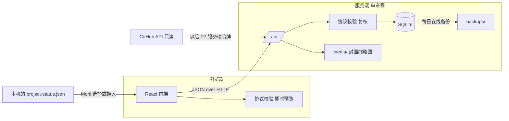

# 05 · 系统形态、技术栈与数据

> 状态：已获批（2026-10-12），采用「前端 + 本机小服务（SQLite）」。下文的版本号是规划时的参考，实施时按 `source-driven-development` 再核实一次。

## 1. 现状调研（2026-10-11，只读）

只看了各仓库的顶层结构、README、`package.json` 和与状态、部署相关的文档，没有运行任何项目。

| 发现 | 对 Dashboard 的意义 |
| --- | --- |
| 工作区里没有 Morii OS，也没有现成的任务或项目管理系统 | 委托书里的「复用 Morii OS」不成立；Dashboard 独立建设，只复用下面这些做法和数据 |
| 六个项目的主检出和 worktree 里都还**没有** `docs/status/project-status.json` | 协议按委托书的约定设计；第一批真实快照到来时做第一次兼容验证 |
| 各仓库已经在用 `claude/…`、`codex/…` 分支前缀，PR 合并记录清楚 | 低成本的报告归属依据；以后 GitHub 同步可以按前缀核实「代码证据」 |
| 各仓库有大量 handoff、validation、ADR 文档 | 是快照 `basis` 和 `evidence_refs` 的天然引用对象 |
| Moriium 有一套状态发布链路：本机采集 → 受限 SSH 接收 → VPS 原子发布静态 JSON；对过期、未知、缺测有明确语义（「超过三小时没有成功采集即过期」「无数据保持空条」「不计算 SLA」） | 新鲜度、未知、过期的语义直接借鉴；以后如需从本机推送快照到 VPS，可复用受限 SSH 收件的做法 |
| Moriium ADR-0003 有 Morii 认可的状态配色语义（灰绿、砖红、土黄、雾蓝、灰紫） | 状态色的语义分配沿用（见 02 第 13 节） |
| Moriium 后台的登录与部署做法：会话不落在发布目录、CSRF、按账户和全局限速、fail2ban、`releases/` + `current` 软链接、持久数据在 `/var/lib/` | P6 部署直接沿用这些做法 |
| Moriium 和 Gallery 用 Astro；Enouia Runtime 桌面端用 React 19 + Vite + TypeScript；本机 Node 24.15、pnpm 10.33；`gh` 已登录 `Morii9961` | 技术栈选择的参照 |
| 现有 VPS 与 Moriium 同机，Nginx + systemd，域名已上线；备案按 Morii 的要求暂缓 | 部署方式与访问方式要考虑备案状态，见第 9 节 |
| `lieflat-charts` 的许可证是 PolyForm Noncommercial | Dashboard 是 MIT 开源仓库，不能把它的模板代码复制进来，见第 8 节 |

## 2. 形态选择

委托书给了三个方向。工作区没有 Morii OS，所以 A 换成最接近的现实替代：放进 Moriium 主站的后台。

| 方案 | 说明 | 优点 | 问题 |
| --- | --- | --- | --- |
| A′ 作为 Moriium 后台的一个模块 | 复用已有登录和 SQLite | 少一套登录 | 把私人工作台和公开博客绑在同一个仓库、同一个进程、同一个故障域；Morii 已明确要独立项目 |
| B 独立的本地桌面应用（Tauri） | 像 Enouia Runtime 一样 | 数据完全在本机 | 手机看不了；和 Enouia Runtime 的「桌面伴侣」定位重叠；要做安装包和签名 |
| **C 浏览器访问的个人控制台** | 一个 Web 应用，先在本机运行，验收后部署到 VPS | 一套代码，本机和 VPS 都能跑；手机电脑看到同一份数据；开源方便 | 部署到公网时需要登录和加固 |

**推荐 C，分两段走**：

1. **本机阶段（P1 到 P5）**：服务只监听 `127.0.0.1`，不需要登录。Morii 在自己电脑的浏览器里用。
2. **VPS 阶段（P6）**：加上单用户登录，部署到现有 VPS，数据从本机导出包迁移过去。之后以 VPS 为唯一数据源，本机实例只用于开发。

## 3. 为什么需要一个很薄的服务端

Morii 说这是一个前端项目。它确实以前端为主，但需要一个很小的服务进程，原因有四个：

1. **数据要落在文件里**。浏览器的 IndexedDB 清缓存就没了，换浏览器、换设备也看不到；一个 SQLite 文件可以备份、复制、检查。
2. **部署到 VPS 后手机和电脑要看同一份数据**，这需要服务端存储。
3. **凭据不能进前端**。以后 GitHub 同步需要令牌，只能放在服务端。
4. **导入要在服务端复核**，不能只信前端的校验结果。

这个服务端只做五件事：保存数据、复核并写入导入、提供静态前端文件、备份与导出、（P6 起）登录。没有队列、没有缓存服务、没有第二个进程、没有外部数据库。

Morii 于 2026-10-12 选定这个形态（不走纯前端）。

## 4. 技术栈

| 层 | 选择 | 理由 |
| --- | --- | --- |
| 运行时 | Node.js 24 LTS | 本机已是 24.15，和 Moriium 一致 |
| 包管理 | pnpm（workspace） | Morii 各项目都在用；版本在 P1 用 `packageManager` 字段锁定 |
| 语言 | TypeScript，严格模式 | 协议类型前后端共用 |
| 前端 | React 19 + Vite | 和 Enouia Runtime 桌面端同一套，Agent 熟悉；`AGENTS.md` 已登记 React 相关 Skill |
| 路由 | React Router（SPA 模式） | 私人应用不需要服务端渲染和 SEO |
| 数据请求 | TanStack Query | 处理缓存、窗口重新聚焦时刷新、写入后失效 |
| 交互原语 | React Aria Components | 对话框、菜单、单选、日期等的键盘与读屏支持；内置中日英的国际化 |
| 样式 | CSS 自定义属性做 token + CSS Modules | 代码只消费颜色、字体、间距的角色；不引入 UI 框架主题 |
| 多语言 | FormatJS（react-intl），ICU 消息 | 整句翻译、复数、语序 |
| 协议校验 | JSON Schema 2020-12 + Ajv | Schema 是正式产物，其他仓库也能用同一份校验；前后端共用 |
| 服务端 | Hono（Node 适配） | 很小，路由和中间件够用 |
| 存储 | SQLite，WAL 模式；优先评估 Node 内置 `node:sqlite`，不满足时用 better-sqlite3 | 单文件、易备份；`node:sqlite` 在 Node 24 的稳定性需要实施前核实 |
| 迁移 | 手写 SQL 迁移文件 + 一个很小的执行器 | 表很少，不需要 ORM |
| 测试 | Vitest（单元、协议样本）+ Playwright（关键流程、截图） | 协议和导入逻辑要有大量样本测试 |
| 代码质量 | Biome（格式化 + 检查） | 一个工具，少依赖；P1 时确认规则覆盖够用 |
| 图标 | Phosphor | `DESIGN.md` 默认 |
| 字体 | Fontsource 本地打包：Inter Variable、Noto Sans SC / JP Variable、一款等宽字 | 自托管，按 unicode-range 分片加载 |
| 小图 | 自己写的 SVG（阶段轴、里程碑格、时间带） | MVP 只有这几种小图，不需要图表库 |

**明确不用**：Next.js 等服务端渲染框架、Tailwind、ORM、全局状态库、第三方登录、Docker（P6 用 systemd，和 Moriium 一致）、任何运行时外部请求（字体、统计、CDN）。

## 5. 仓库结构

```text
moriium-dashboard/
├── apps/
│   ├── web/                 React 前端
│   └── server/              Hono 服务端 + SQLite
├── packages/
│   └── protocol/            Status Protocol：Schema、类型、校验、规范化、差异比较
│                            前后端共用，不依赖 React，也不依赖服务端
├── fixtures/
│   ├── protocol/            合法与非法的快照样本，覆盖 03 和 04 列出的每种情况
│   └── demo/                演示数据，全部虚构
├── docs/
│   ├── planning/            本规划
│   ├── status/              Dashboard 自己的状态快照
│   ├── protocol/            协议正式文档与各版本 Schema（P1 从 planning/ 迁入）
│   └── adr/                 架构决定
├── deploy/                  systemd、Nginx 示例（P6）
├── AGENTS.md  CLAUDE.md  DESIGN.md  README.md  LICENSE
└── .github/workflows/       CI
```

`packages/protocol` 单独成包，是因为它是整个产品的核心契约：没有界面也能测试，以后也可以给其他仓库当本地校验工具。

## 6. 运行时边界



数据目录由环境变量 `MORIIUM_DASHBOARD_DATA` 指定：本机默认是仓库外的一个目录（P1 时和 Morii 确认位置），VPS 上是 `/var/lib/moriium-dashboard/`。数据目录永远不在 Git 仓库里。

## 7. 数据模型

协议数据和 Morii 自己的数据分开存。快照只增不改（规范化结果是派生的，原文不动）。

| 表 | 主要字段 | 说明 |
| --- | --- | --- |
| `projects` | `id`（即 project_id）、三语名称、分类、跟踪方式（协议 / 手动）、关注状态、优先级、新鲜度阈值、负责 Agent 与范围说明、链接、手动项目的「正在」和「下一步」、关键日期、核心里程碑 ID 列表、排序、创建与更新时间 | 项目登记表 |
| `status_snapshots` | `id`、`project_id`、`snapshot_at` 原文、`snapshot_at` UTC、`schema_version`、接收规则版本、内容指纹、原文指纹、原文、规范化 JSON、提醒列表、规范化记录、报告归属及其依据（选择 / 分支推断 / 文件字段）、导入批次、文件名、`superseded_by`、`deleted_at` | 快照与历史 |
| `manual_milestones` | `project_id`、标题、`lang`、状态（与协议的里程碑状态同一组枚举）、可选目标日期、排序、时间 | 手动项目的里程碑（可选） |
| `import_batches` | 时间、文件数、导入数、跳过数及原因 | 导入记录与撤销 |
| `acceptance_records` | `project_id`、`milestone_id`、通过或退回、说明、时间、依据的快照 | Morii 的验收 |
| `item_states` | `project_id`、类别（待决定 / 阻塞）、文本指纹（或以后的条目 ID）、处理状态、结论、稍后到期日、时间 | 待决定和阻塞的处理状态 |
| `tasks` | 标题、`lang`、项目、截止日期、状态、来源快照与下一步文本、创建与完成时间 | 基本任务 |
| `focus_days` | 日期、精力、焦点条目（≤ 3，指向任务或自由文本） | 今日焦点 |
| `works` | 标题、`lang`、类型、日期、项目、链接、封面文件、一句话、珍藏、时间 | 成果 |
| `settings` | 语言、主题、时区、一周起始日 | |
| `audit_log` | 时间、动作、对象、摘要 | 导入、删除、恢复、验收等 |

「当前状态」不存冗余字段，查询时取该项目 `snapshot_at` 最晚且未删除、未被替换的快照。数据量很小，没有性能问题。

## 8. 隐私与开源边界

仓库公开，数据私有。

| 进仓库 | 永远不进仓库 |
| --- | --- |
| 代码、协议、Schema、文档 | SQLite 数据库、备份、导出包 |
| 虚构的演示数据和协议样本 | 真实的项目快照（Dashboard 自己的除外，它本来就是公开项目的状态） |
| `.env.example` | `.env`、任何令牌和口令 |
| 部署配置示例（不含地址） | 服务器地址、本机绝对路径、私人计划、预算、课程 |

**防护**
- `.gitignore` 覆盖数据目录、数据库文件、`.env`、导出包。
- CI 加一个公开树审计（参考 Moriium 的 `audit:public`）：拒绝数据库文件、导出包、常见密钥形态、内网和公网 IP 字面量进仓库。
- 演示数据用虚构项目（例如 `demo.alpha`），不用六个真实 ID 编造状态。
- 文档里不写服务器地址和本机路径。

**许可证**
- 代码用 MIT，和 Moriium 一致（2026-10-12 已决定）。
- 字体均为 OFL，随仓库附上第三方声明。
- `lieflat-charts` 只当选型顾问（选什么图、怎么读），不复制它的模板代码。`dataviz` 用于校验配色和交互。

## 9. 部署（P6）

沿用 Moriium 在同一台 VPS 上已经验证过的做法：

- 系统账户 `moriium-dashboard`，无登录 shell。
- `/var/www/moriium-dashboard/releases/<sha>/` + `current` 软链接，保留最近几份，可回滚。
- 持久数据在 `/var/lib/moriium-dashboard/`（数据库、媒体、备份、会话），与发布目录分开。
- systemd 管理单个 Node 进程，只监听 `127.0.0.1`；Nginx 反向代理并提供 TLS。
- 登录：单个账户，口令用 scrypt 哈希；会话 cookie `HttpOnly`、`Secure`、`SameSite=Strict`；按账户和全局限速；fail2ban 监控登录失败日志。
- 备份：每日本机备份 + 定期拉回 Morii 的电脑（再由 Morii 决定是否放进 OneDrive）。上线前做一次恢复演练。
- 迁移：本机「导出全部数据」→ VPS「从导出包恢复」→ 核对记录数和快照指纹。

**访问方式**延后决定（2026-10-12 Morii：回头再说），最晚在 P5 结束、P6 开始前定。两个选项：

| 选项 | 做法 | 优点 | 代价 |
| --- | --- | --- | --- |
| 私网访问（推荐） | 服务不对公网开放，通过 Tailscale 或 WireGuard 访问；仍保留登录 | 私人数据不暴露在公网；不牵涉备案下的网站内容问题 | 手机和电脑要装客户端；在日本旅行时的连通性要实测 |
| 公网子域名 | 例如 `dash.` 子域名 + 登录 | 随处可用 | 多一个公网攻击面；备案暂缓期间同一域名下新增站点的风险需要另行确认 |

这一项只影响 P6，可以到 P5 结束时再定。

## 10. 安全要点

**本机阶段**
- 只绑定 `127.0.0.1`。
- 校验 `Host` 头只接受 `127.0.0.1` 和 `localhost`，防止 DNS 重绑定让网页借浏览器访问本机服务。
- 写请求校验 `Origin`，并要求一个自定义请求头。
- CSP：不允许内联脚本，不允许任何外部来源。
- 上传限制：快照 1 MiB，封面 5 MiB，只接受图片类型。

**任何阶段**
- 快照内容只当数据，见 03 第 6.4 节。
- 不使用 `dangerouslySetInnerHTML`，不渲染用户或快照里的 HTML。
- 没有遥测、统计和第三方请求。

## 11. 接口草案

| 方法与路径 | 作用 |
| --- | --- |
| `GET /api/overview` | 概览所需的全部数据，一次取回 |
| `GET /api/projects` / `GET /api/projects/:id` | 项目列表、详情（含当前快照） |
| `POST /api/projects` / `PATCH /api/projects/:id` | 登记、修改项目 |
| `POST /api/imports/check` | 服务端校验与预览（不写入） |
| `POST /api/imports` | 复核并写入一批快照 |
| `DELETE /api/imports/:batch` | 撤销一次导入 |
| `GET /api/projects/:id/snapshots` | 历史列表 |
| `GET /api/snapshots/:id` / `GET /api/snapshots/:id/raw` | 快照详情、原文 |
| `GET /api/snapshots/compare?a=&b=` | 对比 |
| `DELETE /api/snapshots/:id` / `POST /api/snapshots/:id/restore` | 移入回收站、恢复 |
| `PUT /api/acceptance/:project/:milestone` | 验收通过或退回 |
| `PUT /api/items/:project/:kind/:key` | 待决定、阻塞的处理状态 |
| `GET/POST/PATCH /api/tasks` | 任务 |
| `GET/PUT /api/focus/:date` | 今日焦点与精力 |
| `GET/POST/PATCH/DELETE /api/works`、`PUT /api/works/:id/cover` | 成果 |
| `GET /api/export`、`GET /api/export/snapshots` | 导出 |
| `GET /api/backups`、`POST /api/backups` | 备份 |
| `GET /api/health` | 进程与数据库状态 |

## 12. 性能预算

- 首屏 JavaScript（压缩后）目标 200 KB 以内；对比、作品页按路由拆分。
- 中日文字体按 unicode-range 分片加载，P2 实测首屏字体体积并定预算。
- 概览一次请求取回全部数据。
- 数据量：几十个项目、几千份快照以内，SQLite 单表查询足够，不做分页以外的优化。
