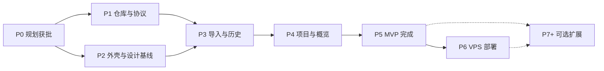

# 06 · MVP 范围、开发路线图与风险

> 状态：已获批（2026-10-12）。决定记录见 [`docs/design-decisions.md`](../design-decisions.md)，正式开发的启动提示词见 [`docs/handoff-2026-10-12-development-kickoff.md`](../handoff-2026-10-12-development-kickoff.md)。功能优先级的完整表格见 [01 第 6 节](./01-product-vision-and-prd.md#6-功能与优先级)。

## 1. MVP 的边界

一句话：**MVP 要能替代「翻各个仓库的 handoff 文档来判断进度」这件事，同时让今天要做的事和做成的东西有一个地方放。**

**MVP 包含**
1. Project Status Protocol v1.0 与 v1.1 的 Schema、接收规则和校验。
2. 手动导入：选择或拖入多个文件、预览、错误解释、确认、撤销；去重、冲突、旧快照处理。
3. 项目登记：预置六个协议项目，可添加手动项目，关注状态与暂停。
4. 项目列表和详情：阶段轴、里程碑格、证据层级、阻塞、下一步、待决定、Morii 的验收记录。**进度展示是首版重点**（02 第 5.4 节）：「还差什么」行、核心里程碑、进入当前阶段的时间、手动项目的手动里程碑。
5. 快照历史：列表、任选两份对比（默认当前与上一份）、时间带、回收站。
6. 概览：今天（精力、焦点）、需要你决定、项目、最近交付、报告新鲜度、Agent 最近报告。
7. Agents 页：每个 Agent 的最后一次报告及其证据构成。
8. 基本任务；从下一步转为任务。
9. 成果登记与作品页。
10. 自动备份、导出。
11. 中日英界面、浅深主题、键盘可达、窄屏可用。
12. Dashboard 用同一机制追踪自己的进度。

**MVP 不包含**
GitHub 同步、本机仓库扫描、Agent 钩子、协议 v1.2（E3、E4）、课程表、周视图、复盘、灵感收藏、制作阶段、命令面板（若有余力可做）、登录与 VPS 部署（P6 单独做）、任何图表库。

## 2. 未来扩展（都不阻塞 MVP）

按「减少手动」的程度分级。每一级都仍然需要 Morii 确认后才写入。

| 级别 | 内容 | 前提 |
| --- | --- | --- |
| L1（MVP） | Morii 触发 Agent 生成，Morii 手动导入 | — |
| L2 | 本机仓库扫描：Dashboard 读取登记过的本机仓库里的 `docs/status/project-status.json`，列出有新快照的项目，仍走预览和确认 | 只在本机实例可用 |
| L3 | GitHub 只读同步：核实 `commit_sha` 是否存在；按 `claude/`、`codex/` 前缀列出已合并 PR；读取默认分支上提交过的快照文件。界面增加「Dashboard 已核实」 | 服务端保存只读的细粒度令牌；快照文件提交进各项目仓库（2026-10-12 已决定） |
| L4 | Agent 钩子：会话结束时提醒或自动生成快照文件（Claude Code 的 hooks、Codex 的 notify 机制） | 机制需实施前核实；只生成文件，不自动导入 |
| L5 | 从本机推送到 VPS：沿用 Moriium 的受限 SSH 收件做法，把快照送进 VPS 上的待确认区 | P6 完成之后 |

**其他扩展**
- 协议 v1.2：03 第 10 节暂缓的 E3、E4，用过 v1.1 后再逐项请 Morii 批准。
- 作品：灵感收藏、照片与视频的制作阶段、Enouia 角色设定、Skills 实验记录。
- 计划：周视图、课程表、重要日期倒计时、每周三问的复盘、长期计划。
- 体验：命令面板、快捷键。
- Moriium 公开的活动数据（只读，标为「用量」，与进度分开）。是否需要，届时再问。

## 3. 阶段路线图

P1 和 P2 可以并行：协议包不依赖界面，界面骨架不依赖协议。

### P0 · 规划获批（2026-10-12 完成）

| 项 | 内容 |
| --- | --- |
| 产出 | `docs/planning/` 全部文档、协议 Schema 草案、Agent 指令模板、Dashboard 初始状态快照 |
| 交付标准 | Morii 批准规划，回答第 7 节的五个问题；批准的内容记入 `docs/design-decisions.md`，`AGENTS.md` 第八节的技术栈等事实更新 |
| Morii 要做的 | 审阅、回答问题 |
| 结果 | 2026-10-12 Morii 回答了五个问题，规划获批；答案见第 7 节和 `docs/design-decisions.md` |

### P1 · 仓库与协议

| 工作包 | 内容 |
| --- | --- |
| 1.1 | 初始化 Git，`.gitignore`、`LICENSE`、`README`；隐私检查后首次提交；创建公开 GitHub 仓库 `Morii9961/Moriium-Dashboard` 并推送（Morii 已授权，步骤见第 6 节） |
| 1.2 | pnpm workspace、TypeScript 严格模式、Biome、Vitest；CI：检查、类型、测试、公开树审计 |
| 1.3 | `packages/protocol`：Schema v1.0 与 v1.1 正式版、类型、Ajv 校验、接收规则（错误、提醒、规范化）、语义校验、编码识别、密钥扫描、内容指纹、差异比较 |
| 1.4 | `fixtures/protocol`：覆盖 03 第 5、6 节和 04 第 5、7 节每一种情况的样本 |
| 1.5 | 命令行检查工具 `pnpm status:check <文件>`，输出和界面一致的问题说明 |
| 1.6 | `docs/protocol/` 正式文档与 Agent 指令模板定稿 |

- **交付标准**：CI 通过；每个样本的结果与文档一致；Morii 用检查工具看一两份真实快照，能看懂输出。
- **Morii 要做的**：决定是否以及何时把 Agent 指令放进其他项目的 `AGENTS.md`（这一步改的是其他仓库，由 Morii 自己或另行授权）。从这时起，各项目就可以开始积累快照，不必等界面做完。
- **规模**：中，6 个工作包。

### P2 · 外壳与设计基线

| 工作包 | 内容 |
| --- | --- |
| 2.1 | 设计样张页：用真实内容（有真实快照就用快照，至少覆盖一个成熟项目、一个持续研发项目和 Dashboard 自己）并排展示两套字体方案、浅深两套颜色 token、状态表达、阶段轴的两三种画法；Morii 选定后逐项记入设计决定 |
| 2.2 | 颜色、字体、间距 token；字体本地打包；主题切换；三语框架；日文敬体常体、中英文空格等文案约定 |
| 2.3 | 应用外壳：响应式导航、路由、空状态、错误边界、「服务未连接」横幅 |
| 2.4 | 服务端骨架：Hono、`/api/health`、SQLite 与迁移、数据目录配置、Host 与 Origin 检查、CSP、每日备份 |

- **交付标准**：样张获 Morii 认可且决定已记录；外壳在两种宽度、两种主题、三种语言下通过检查，键盘可走通，对比度达标；服务端在空数据库上启动并生成备份。
- **Morii 要做的**：看一次样张，逐项拍板。
- **规模**：中，4 个工作包。
- **用到的 Skill**：`frontend-design`（只用于样张里框架没覆盖的决定）、`ui-ux-pro-max`（悬而未决的无障碍与配色问题）、`dataviz`（状态色和小图的色盲可区分度）。

### P3 · 导入与历史（MVP 核心）

| 工作包 | 内容 |
| --- | --- |
| 3.1 | 项目登记：预置六个；设置页的项目管理 |
| 3.2 | 导入对话框：多文件、即时预览、服务端复核、确认、撤销；导入记录页 |
| 3.3 | 快照存储、当前状态查询、去重、同一时刻冲突、旧快照入历史 |
| 3.4 | 历史列表、任选两份对比（默认当前与上一份）、时间带、回收站与恢复 |
| 3.5 | 导出全部、只导出快照原文 |

- **交付标准**：六个项目的真实快照都已导入；端到端测试覆盖重复、冲突、旧快照、非法文件、带 BOM、UTF-16、代码块包裹、疑似密钥、未登记 ID、在错误的项目页导入；Dashboard 导入了自己的快照，并从 Git 历史补导至少一份旧快照。
- **Morii 要做的**：用真实文件试导一轮，指出看不懂的提示。
- **规模**：大，5 个工作包，单个较重。

### P4 · 项目与概览

| 工作包 | 内容 |
| --- | --- |
| 4.1 | 项目列表：表格与手机卡片、阶段轴、里程碑格、新鲜度 |
| 4.2 | 项目详情：来源行、里程碑与证据、验收操作、阻塞、下一步、待决定 |
| 4.3 | 待决定与阻塞的处理状态，跨快照匹配 |
| 4.4 | 手动项目与关注状态 |
| 4.5 | 概览：需要你决定、项目、报告新鲜度、Agent 最近报告、最近交付（此时只有验收通过的里程碑） |
| 4.6 | 进度展示打磨：「还差什么」行、核心里程碑、进入当前阶段的时间、手动里程碑；用六个项目的真实快照逐个走查并修改 |

- **交付标准**：01 第 8 节的 30 秒测试和来源抽查通过；六个项目逐个走查，Morii 在每张项目卡上 10 秒内能答出「做到哪里、还差什么、下一步、要我做什么」。
- **Morii 要做的**：做一次 30 秒测试，并和 Agent 一起把六个项目逐个过一遍。
- **规模**：大，6 个工作包，单个较重。

### P5 · MVP 完成

| 工作包 | 内容 |
| --- | --- |
| 5.1 | Agents 页 |
| 5.2 | 今日焦点、精力、低精力与休息模式 |
| 5.3 | 任务；从下一步转为任务 |
| 5.4 | 成果登记、封面处理、作品页、最近交付 |
| 5.5 | 收尾：有余力时做 P1 项（粘贴 JSON、命令面板）；`web-design-guidelines` 评审；无障碍走查 |
| 5.6 | 可选：Enouia 的个人化细节，先给 Morii 两个风格选项 |

- **交付标准**：01 第 8 节四条全部成立，包括一周的实际使用；打标签 `v0.1.0`。
- **Morii 要做的**：真实用一周，记下不顺手的地方。
- **规模**：大，6 个工作包。

### P6 · VPS 部署

2026-10-16 推进补充：Morii 已允许在真实试用与产品验收仍待完成时，先做 P6 工程准备（导出包恢复、登录与部署准备）。这不填补 P4/P5 验收，不触发 `v0.1.0`，也不代替下面的正式恢复、访问方式、口令设置与部署授权。P6 PR 仍由 Morii 决定合并；P5 的顺序合并授权不延伸至本阶段。

| 工作包 | 内容 |
| --- | --- |
| 6.1 | 从导出包恢复到空实例 |
| 6.2 | 单用户登录、会话、限速、登录日志 |
| 6.3 | systemd、Nginx 配置、发布脚本、回滚、备份拉回 |
| 6.4 | 按届时决定的访问方式配置（私网或公网子域名） |
| 6.5 | 部署验收清单：停止与重启、回滚、恢复演练、登录锁定、安全头、数据路径不可访问 |

- **交付标准**：动服务器之前取得 Morii 对本次部署的明确授权；清单全部通过；数据从本机迁移并核对快照指纹；此后 VPS 为唯一数据源。
- **Morii 要做的**：授权部署；自己设置登录口令（Agent 不代填口令）；选择访问方式。
- **规模**：中，5 个工作包。

### P7+ · 可选扩展

第 2 节的内容，每一项单独立项、单独批准，互不依赖。

## 4. 开发节奏

**工作包**
- 一个工作包 = 一个分支 + 一个 PR，大小以 Morii 一次能看完为准。
- 分支沿用现有前缀：`claude/<主题>`、`codex/<主题>`。这本身就是 Agents 页的归属依据。
- PR 说明写：改了什么、怎么验证的（命令和结果；界面改动附浅深两张截图）、风险、是否更新了状态快照。
- 合并由 Morii 决定，不开自动合并。
- 风险高的 PR（协议、导入、登录、部署）由另一个 Agent 复核后再给 Morii。

**每个界面工作包的完成定义**
- 单元测试和相关的端到端测试通过。
- 桌面与 375px、浅色与深色、中日英三种界面语言、键盘、对比度、减少动画都检查过（`AGENTS.md` 第二节第 6 条）。
- 用真实快照或真实形态的样本，不用占位文字。

**Morii 的参与点**，一共七次，其余时间不需要盯着：

| 时间点 | 做什么 | 大约多久 |
| --- | --- | --- |
| P0 结束 | 批准规划，回答五个问题 | 一次阅读 |
| P1 结束 | 看检查工具对真实快照的输出；决定是否在其他项目启用快照指令 | 十几分钟 |
| P2 中途 | 看样张，逐项拍板 | 一次讨论 |
| P3 结束 | 用真实文件试导 | 十几分钟 |
| P4 结束 | 30 秒测试；六个项目的进度展示逐个过一遍 | 半小时左右 |
| P5 结束 | 用一周，给反馈 | 一周日常使用 |
| P6 开始前 | 授权部署，设口令，选访问方式 | 一次 |

**时间**：不写具体日期。六个实施阶段共 32 个工作包。按 Morii 课程之外的时间，一个阶段大致一到两周；P1 和 P2 并行可以省出一段。阶段之间不赶，参与点也不需要排在同一天。

## 5. Dashboard 如何追踪自己的进度

和其他项目用同一套机制，不做自我监控。

**已初始化**（本次规划时建立）
- [`docs/status/project-status.json`](../status/project-status.json)：`project_id: "morii.dashboard"`，`stage: "planning"`，`overall_progress: null`，`branch` 和 `commit_sha` 为 null（仓库还没建立）。
- [`docs/status/PROJECT_STATUS.md`](../status/PROJECT_STATUS.md)：同一内容的可读版本。
- 里程碑 ID 现在就固定，对应各阶段，以后不改名：

| `id` | 对应 |
| --- | --- |
| `p0-plan-approval` | P0 规划获批 |
| `p1-repo-protocol` | P1 仓库与协议 |
| `p2-shell-design` | P2 外壳与设计基线 |
| `p3-import-history` | P3 导入与历史 |
| `p4-projects-overview` | P4 项目与概览 |
| `p5-mvp` | P5 MVP 完成 |
| `p6-vps-deploy` | P6 VPS 部署 |

**更新规则**
- 每个阶段结束时，以及 Morii 在 Dashboard 的会话里说「生成项目状态快照」时更新。
- 阶段的交付标准没有全部达到，对应里程碑不写 `done`。
- 需要 Morii 验收的里程碑，在对应参与点之前保持 `human_acceptance: "pending"`。
- `overall_progress` 整个 MVP 期间保持 null，用阶段和里程碑表达进度。以后如果 Morii 同意用某个严格依据（例如 MVP 验收清单的完成项数）计算，再改。
- 规划阶段不写任何「已实现」的内容。

**导入自己**
- P3 完成后，Dashboard 导入自己的当前快照；再用 `git show` 从历史里取出更早的版本补导，顺便验证「旧快照只进历史」的规则。
- 之后和其他项目一样，由 Morii 手动导入。

## 6. GitHub 仓库建立步骤（P1.1 执行）

1. 在当前目录 `git init`，默认分支 `main`。
2. 加 `.gitignore`（数据目录、数据库、`.env`、导出包、`node_modules`）、`LICENSE`（MIT）、简短 `README`。
3. 隐私检查：文档里没有服务器地址、本机绝对路径、邮箱、令牌。
4. 首次提交：现有的 `AGENTS.md`、`CLAUDE.md`、`DESIGN.md`、`docs/`。
5. 创建公开仓库 `Morii9961/Moriium-Dashboard`（名称与 `Moriium-Gallery` 一致）。Morii 已授权（2026-10-11「稍后你可以自己新建仓库然后上传代码」，2026-10-12 同意名称、公开与 MIT）。第 3 步的隐私检查不通过就不推送。
6. 推送；设置仓库描述和主题标签。
7. 下一份状态快照写入真实的 `branch` 和 `commit_sha`。

## 7. 五个问题的答案（2026-10-12）

| # | 问题 | 答案 | 影响 |
| --- | --- | --- | --- |
| 1 | 形态 | **前端 + 本机小服务（SQLite）** | 按 05 第 3、4 节的技术栈执行 |
| 2 | 首版范围 | **按 MVP 执行，但各项目的进度展示要做好** | MVP 范围不变；进度展示列为首版重点：「还差什么」行、核心里程碑、进入当前阶段的时间、任选两份对比与时间带（从 P1 提前）、手动项目的手动里程碑；P4 增加 4.6 逐项目走查（02 第 5.4 节） |
| 3 | 协议扩展 | Morii 交给规划方决定：**批准 E1、E2 组成 v1.1，E3、E4 暂缓；`project_id` 只规定格式** | 03 第 10 节；Schema v1.1；Agent 指令模板改为写 v1.1 |
| 4 | 开源边界 | **同意**：`Moriium-Dashboard`、公开、MIT；各项目的 `docs/status/` 两份文件提交进各自仓库 | P1.1 可直接建仓推送；各项目启用快照指令仍由 Morii 在那些仓库里操作 |
| 5 | VPS 访问方式 | **回头再说** | 最晚在 P5 结束、P6 开始前决定；P1 到 P5 不受影响 |

视觉方向（字体、配色、阶段轴的画法）不在这五个问题里，P2 用样张逐项商定。

## 8. 风险

| # | 风险 | 可能的后果 | 应对 |
| --- | --- | --- | --- |
| R1 | 快照质量取决于 Agent | 自报说得比实际好，或把没验收的写成已验收 | 证据三层分开显示；Morii 自己的验收记录优先；指令模板写明规则；L3 用 GitHub 核实 |
| R2 | Morii 不想导入 | 数据过期，Dashboard 失去意义 | 一次拖入多个文件；过期提示温和而清楚；L2 本机扫描减少操作；不要求每天做 |
| R3 | 变成又一个要喂的系统 | 维护成本超过收益 | 手动输入只有焦点、决定、验收、成果；任务可以不用；G4 作为验收标准 |
| R4 | 范围膨胀 | MVP 一再推迟 | MVP 清单写死；Studio、Planner 的其余部分全部在 P7 之后，各自单独批准 |
| R5 | 公开仓库泄露隐私 | 地址、路径、私人计划进入公开历史 | 数据目录在仓库外；CI 公开树审计；演示数据虚构；文档不写地址 |
| R6 | 许可证冲突 | `lieflat-charts`（PolyForm Noncommercial）的代码进入 MIT 仓库 | 只用它做选型参考，小图自己写 |
| R7 | 协议与各仓库不同步 | 不同项目写出不同变体 | Schema 和检查工具放在 Dashboard 仓库；版本规则；接收规则宽严分明 |
| R8 | 文本匹配不稳 | 待决定的「已处理」状态在 Agent 改措辞后丢失 | v1.1 的条目 `id`；没有 `id` 时退回规范化文本匹配 |
| R9 | 内置 SQLite 的稳定性 | `node:sqlite` 在 Node 24 仍有变动 | P2 前核实；备选 better-sqlite3；数据访问集中在一层 |
| R10 | 中日文字体体积 | 首屏变慢 | 可变字体 + 分片；P2 实测并定预算 |
| R11 | 数据库放进同步盘 | OneDrive 在写入途中同步导致损坏 | 数据库不放同步目录，只把备份文件放过去 |
| R12 | 时区 | 快照时间被误读，排序出错 | 强制带时区；存 UTC 和原始偏移；默认按 Asia/Shanghai 显示 |
| R13 | 「状态」一词混用 | 和 Moriium 的「运行状态」混淆 | 界面和文档统一叫「项目快照」，「运行状态」只指站点在线 |
| R14 | 公网暴露与备案 | 私人数据面临攻击；备案暂缓期间新增站点的影响不明 | 推荐私网访问；P6 之前再确认 |
| R15 | 主站真实状态与描述不一致 | 委托书说主站「主要剩上线」，但仓库里有 2026-10-05 的 VPS 部署记录，正式验收未完成 | Dashboard 不替 Agent 判断，显示快照怎么说；由生成主站快照的 Agent 核对后写明 |

## 9. 假设

- Dashboard 只有 Morii 一个用户。
- 主要设备是 Windows 电脑上的 Chromium 系浏览器；手机以查看为主。
- 快照由 Morii 手动触发，频率由 Morii 决定，可能一周一次，也可能几周一次。
- 快照的文字内容是中文（协议规定摘要为中文）。
- 首版不接入任何外部服务，因此本机阶段不需要任何令牌。
- 没有现成的任务系统需要迁移。如果 Morii 在别处（例如 Notion）已有在用的任务清单，请告诉我，MVP 的任务功能可以保持更简，或者改为只读导入。

## 10. 下一步

1. 五个问题的答案已记入 `docs/design-decisions.md`，`AGENTS.md` 第八节已更新。
2. 正式开发在新的会话里进行，启动提示词见 [`docs/handoff-2026-10-12-development-kickoff.md`](../handoff-2026-10-12-development-kickoff.md)。
3. 从 P1.1 开始；P1 与 P2 可以交替推进。

**规划已于 2026-10-12 获批，可以开始实施。P6 部署仍需 Morii 届时另行授权。**
