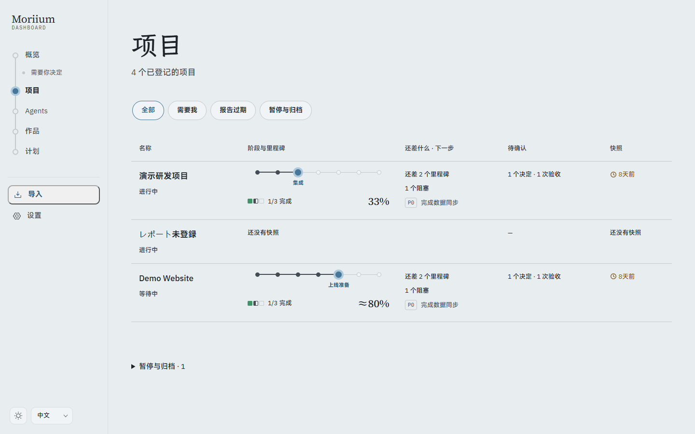
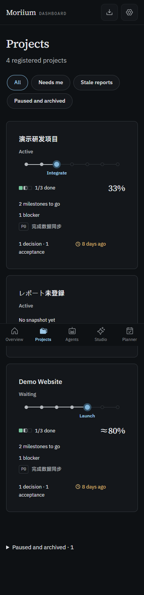

# P4.1 · 项目列表验证

- 独立临时数据库，全部为 `demo.*` 虚构数据；没有写入正式数据目录。
- `pnpm verify`：292 个测试通过，类型检查与公开树审计通过；保留原有 8 个 CSS 特异性提醒。
- `pnpm build`：生产构建通过。
- Chrome 生产页面：1440px / 375px × 浅色 / 深色 × 中日英，12 组无横向溢出，键盘 Tab 和 Enter 可打开项目。减少动画模式开启。无外部请求、无 CSP 错误。首次 favicon 404 为已有资源缺失。
- 颜色沿用现有 token；既有对比度测试覆盖浅深正文、次要文字、强调与状态文字。里程碑同时有形状与完成数，不只依赖颜色。
- 核心里程碑仅影响小图，不改变整体百分比；未知不进入百分比分母，无可计项显示横线。暂停和归档默认收起。
- 分类、排序与手动项目内容在 P4.4 的登记扩展中接入；验收与处理状态的计数在 P4.2 / P4.3 接入。
- 本机全部截图和机器记录保留在被忽略的 `screenshots/p4-1/`；下面两图只有虚构数据。

