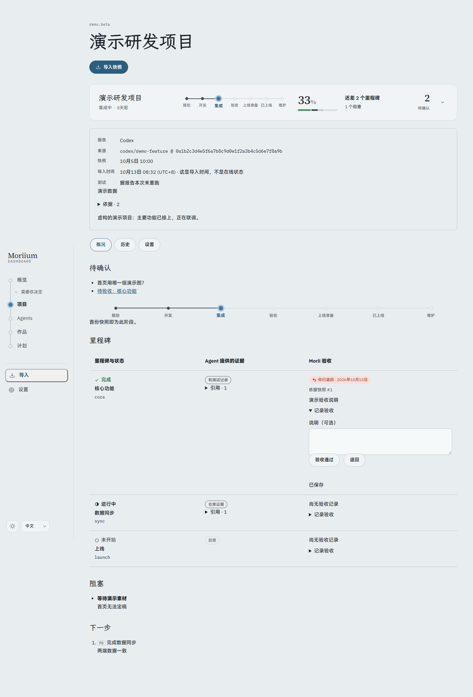
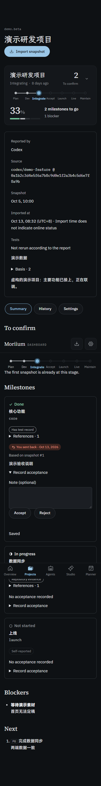

# P4.2 · 项目详情与验收

- `pnpm verify`：296 个测试通过，类型检查与公开树审计通过。8 个既有 CSS 提醒，新增 1 个不同表格间的特异性提醒。
- `pnpm build` 通过。Chrome：1440px / 375px × 浅深 × 中日英，12 组，无页面溢出、CSP 错误或外部请求；键盘进入详情，减少动画模式；逐组退回、通过、刷新核对持久化。
- 集成测试覆盖：人工记录独立于报告且绑定来源快照；矛盾报告不会覆盖；旧页面写入 409；未完成里程碑不能验收通过；疑似密钥只返回错误码；写入保护与导出；连续历史阶段及删除回退。
- 完整里程碑和全部下一步、来源、报告与导入时间均可查。报告验收与人工记录分列；估算和按里程碑计算保持来源提示。详情设置目前跳到登记页，P4.4 补完整设置。
- 截图只包含虚构 `demo.*` 数据，正式数据库未写入。本机完整记录在被忽略的 `screenshots/p4-2/`。

