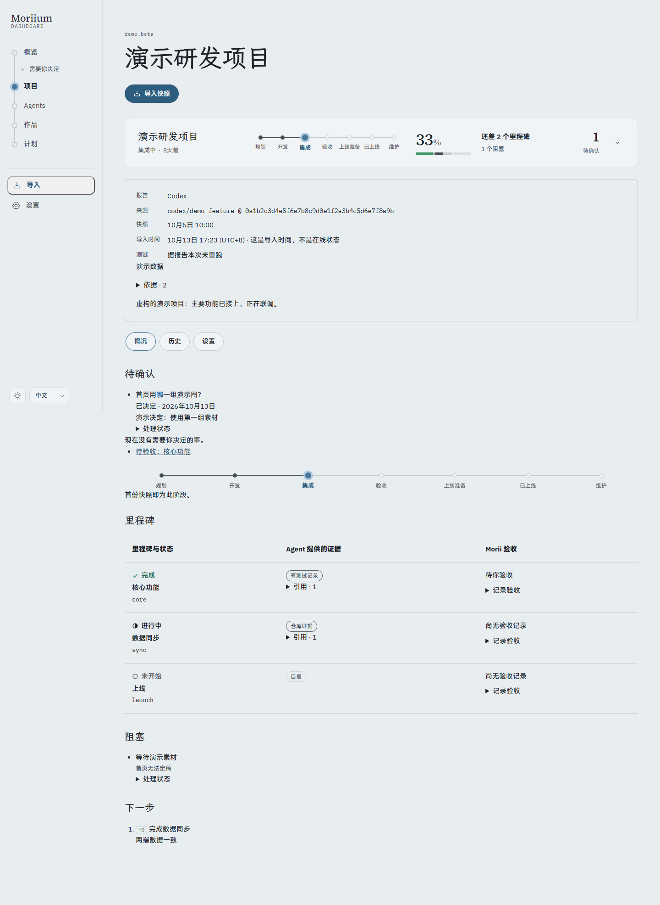
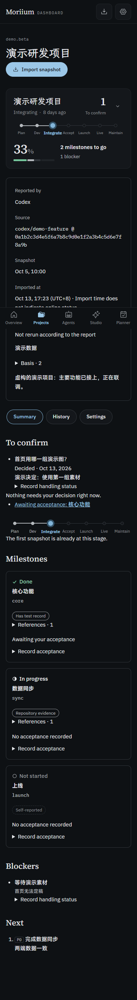

# P4.3 · 跨快照处理状态

- 完整检查通过，299 个测试；生产构建通过。
- Chrome 12 组：1440px / 375px、浅深、中日英，减少动画，键盘提交决定、刷新留存。无页面溢出、CSP 错误或外部请求。沿用既有状态与文字 token。
- 集成验证：稳定 ID 改措辞仍匹配；无 ID 按协议 `itemKey` 的规范化文本做 SHA-256；改措辞视为新项；已决定项在新报告中重复时标记；消失项按读模型归档；上海日界线到期；非法日期、无结论决定、错误类别状态与过期页面写入拒绝。
- 人工记录保持独立、事务与审计；处理状态纳入导出。已知晓只表示知晓，不改变快照阻塞。
- 本机完整截图与证据在被忽略的 `screenshots/p4-3/`，正式数据库未写入。

