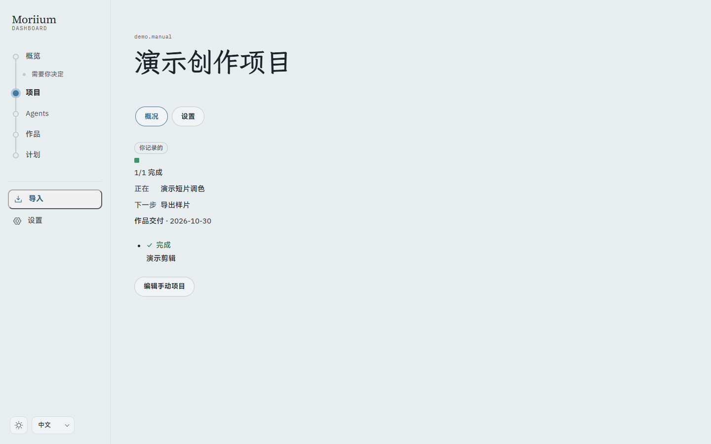
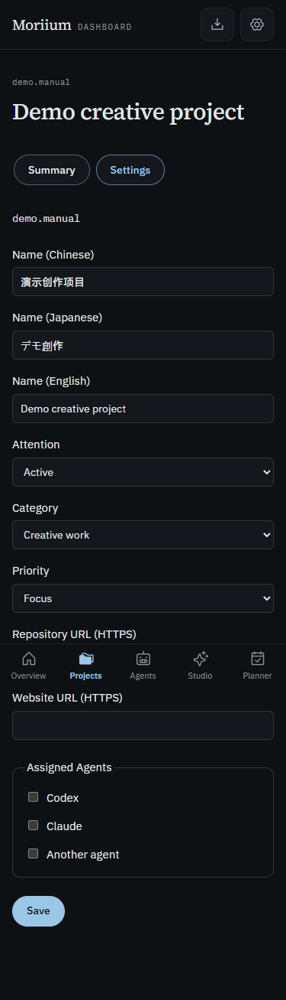

# P4.4 · 手动项目与项目设置

- `pnpm verify`：305 个测试通过，生产构建通过。
- Chrome 12 组桌面/375px、浅深、中日英：手动里程碑的键盘保存与刷新、三语名称和分类/优先级设置保存、列表与概览显示、减少动画检查通过；无横向溢出、CSP 错误或外部请求。浅深截图已查看，样式沿用既有对比度 token。
- 手动项目有正在、下一步、关键日期和可选里程碑，标为「你记录的」；不接收协议快照。保持里程碑 ID，通过原子更新保存，旧页面编辑冲突拒绝。
- 设置补齐三语名称、分类、关注状态、优先级、新鲜度、核心里程碑、Agent 分工、HTTPS 仓库与站点链接；列表按分类、排序并支持筛选。
- 集成验证覆盖：稳定 ID、导出、非法日期、跨项目 ID、疑似密钥、事务回滚、协议/手动隔离、链接校验与过期设置写入。
- 本机完整证据在被忽略的 `screenshots/p4-4/`；正式数据库未写入。

