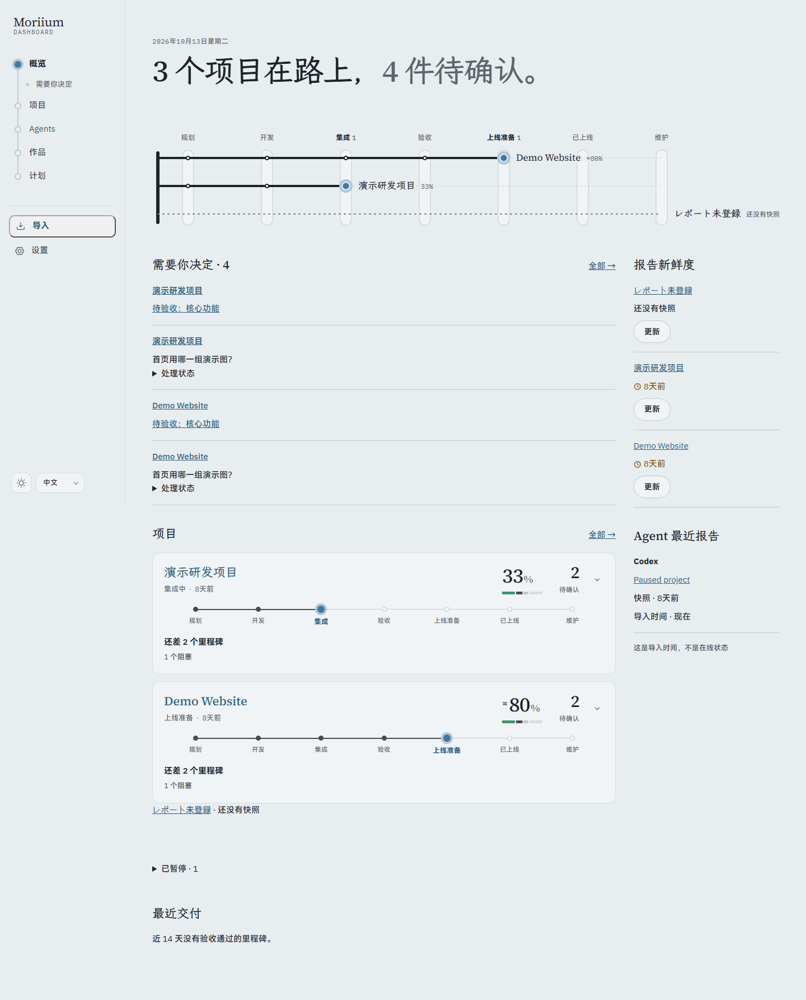
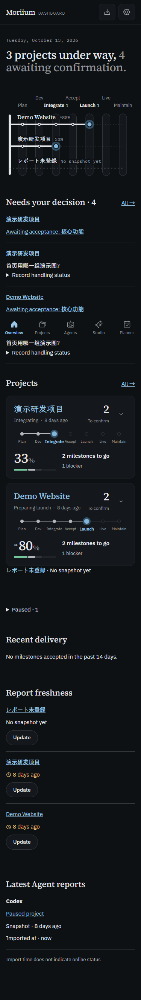

# P4.5 · 概览

- `pnpm verify`：301 个测试通过；生产构建通过。
- Chrome 12 组桌面/375px、浅深、中日英，概览及全部待确认页；键盘入口、减少动画，无横向溢出、CSP 错误或外部请求。沿用既有对比度 token。
- `/api/overview` 一次获取项目、待处理决定与待验收、最近报告和近 14 天人工验收交付。已决定与未到期的稍后不计入待确认，暂停项目不催办；Agent 自报验收不成为最近交付。
- 集成测试验证人工决定/验收后的计数与交付，以及补导历史时 Agent 最近导入报告可早于项目当前快照；导入时间不表示在线。
- 今天、精力、任务、成果登记仍在 P5，本包没有实现这些功能。
- 下图是虚构 `demo.*` 数据；完整本机证据在被忽略的 `screenshots/p4-5/`。

