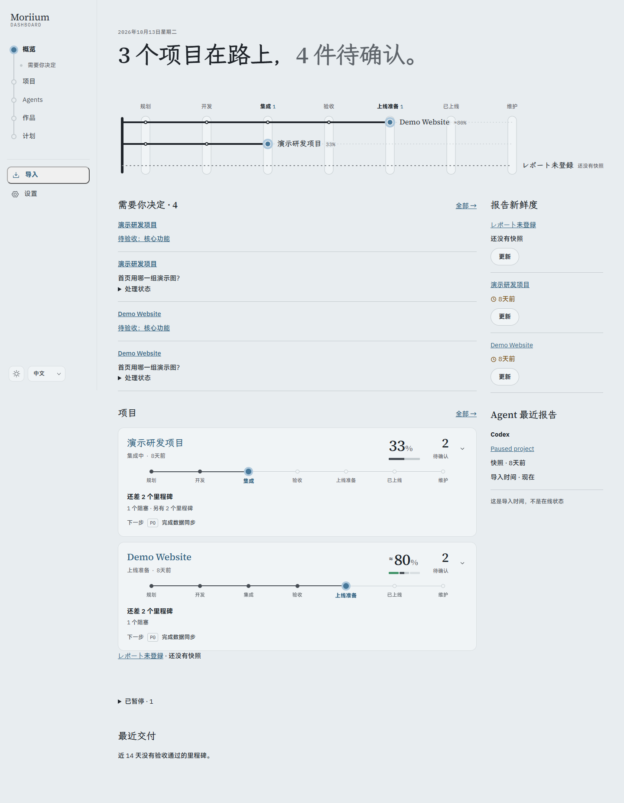
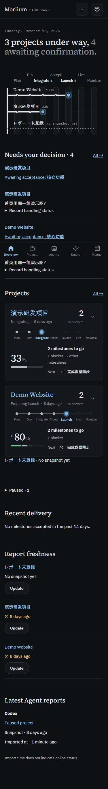

# P4.6 · 六项目走查与进度打磨

## 工程与界面证据

- `pnpm verify`：306 个测试通过，类型检查和公开树审计通过；11 个 CSS 特异性提醒，0 个错误。生产构建通过。
- 虚构 `demo.*`：1440px / 375px × 浅深 × 中日英，12 组。键盘进入项目、验收链接聚焦里程碑、核心小图选择不改变整体百分比、暂停说明保存与折叠区显示、减少动画检查通过。使用既有对比度 token 和测试。
- 六项目真实内容：只读打开原有正式数据库，用 SQLite 备份到仓库外临时目录，在副本上执行迁移。概览、列表与六个详情 × 12 组，共 96 页，无横向溢出、CSP 错误或外部请求；详情行数与对应快照一致。
- 六个项目的桌面卡片已逐个查看：阶段、未完成与未知项、第一条 P0 / P1 下一步、决定与验收数量均可读；完整详情保留全部里程碑及来源。
- 复核期间有一次页面加载失败，该轮未计为通过。保持构建固定后，最终完整 96 页矩阵通过。
- 本机私有截图、逐页机器记录及数据位置记录在被忽略的 `screenshots/p4-6-real/`。没有提交真实快照、私有路径或截图，没有写入真实验收或决定。

## 调整与语义

- 概览长条直接显示下一步；核心里程碑和 12 项上限同时作用于长条和列表小图，并保留隐藏数量。
- 核心小图不改变百分比、未知分母或全项目待确认数。`overall_progress: null` 不画估算条；没有可计里程碑显示横线。
- 证据未注明独立于自报；仓库或测试证据、报告验收、人工验收独立统计。来源时间标明时区，导入时间仍不表示在线。
- 处理状态锚点按项目和类别区分；项目三语名称在概览各区域一致；规划 01 F7 的可选暂停原因已补齐。

这份证据支持工程完成与开发方走查；Morii 的 30 秒测试、六项目各 10 秒检查和来源抽查仍待进行。P4 里程碑保持 `in_progress`、人工验收保持 `pending`。

## 仅虚构数据截图

