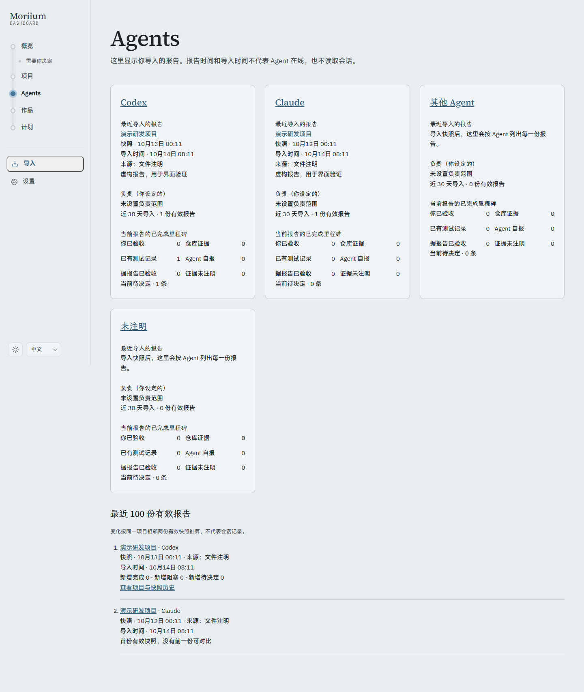
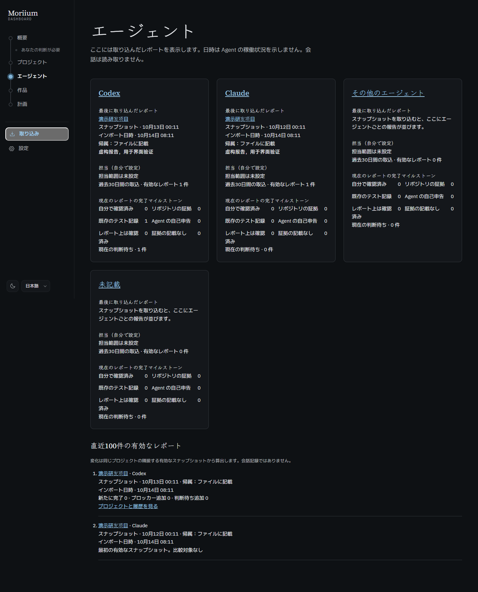

# P5.1 · Agents

报告只来自手动导入的有效快照。最后导入时间与快照时间分别显示，归属注明文件、导入选择、分支推断或未注明。当前已完成里程碑的证据与人工验收分别统计，可重叠；这些数字不代表 Dashboard 核实，也不排名。近期变化按同一项目相邻的有效快照计算。

- `pnpm verify`：309 个测试通过，类型和公开树审计通过；11 个既有提醒（CSS 特异性和未使用导入）。
- `pnpm build`：生产构建通过。
- `node scripts/p5-qa.ts p5-1`：1440px / 375px × 浅深 × 中日英；分组与报告数量、键盘进入 Agent 详情、窄屏无整页横向溢出、减少动画偏好、CSP 和零外部请求通过。虚构数据独立临时数据库，未打开正式数据库。
- 人工检查桌面浅深及英文窄屏截图，文字换行正常；沿用既有墨色和强调文字 token，已有对比度测试通过。
- 测试覆盖旧报告后补导、跨 Reporter 变化、删除/替换、当前里程碑去重和未知来源；本机工程证据不等于 Morii 验收。

截图只使用虚构内容：

本工作包不更新阶段快照；P5 尚未结束，P4 人工验收仍待记录。一周试用及 v0.1.0 标签尚未进行。
