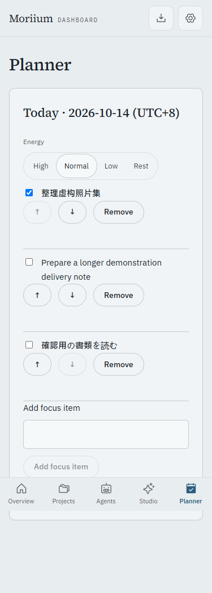
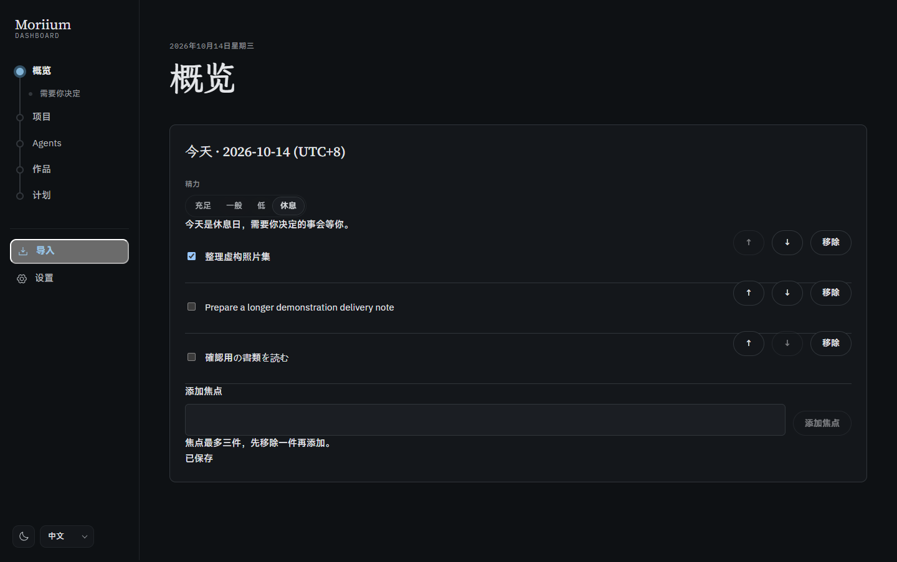

# P5.2 · 今日焦点与精力

最多三条焦点，支持勾选、移除、键盘上移/下移；下一步和待决定可加入今天。当天精力四档调整概览信息量。上海日历跨天回到未选择，不保留精力历史；数据库只保留一行当天安排，下一次保存覆盖旧日，导出只含当天。

- `pnpm verify`：313 个测试、类型和公开树审计通过；11 个既有提醒。
- `pnpm build`：生产构建通过。
- `node scripts/p5-qa.ts p5-2`：1440 / 375 × 浅深 × 中日英，添加三项、重排、勾选后重载、低精力折叠、休息隐藏新鲜度、恢复正常、移除；检查无溢出、CSP、外部请求、减少动画偏好。
- 测试覆盖上海午夜、旧日写入拒绝、版本冲突不丢记录、条目上限、语言/ID/空白/密钥拒绝、CSRF 和导出。
- 使用临时虚构数据库；未打开正式库，迁移 0008 尚未在正式数据上执行。

协议 `needs_morii` 没有优先级字段，低精力只保留明确设了截止日期的待决定，不凭文字猜 P0。其余在可展开区保留。P0 下一步仍可手动加入今天。

本工作包不更新阶段快照，P5 与 Morii 的一周试用均尚未结束。
