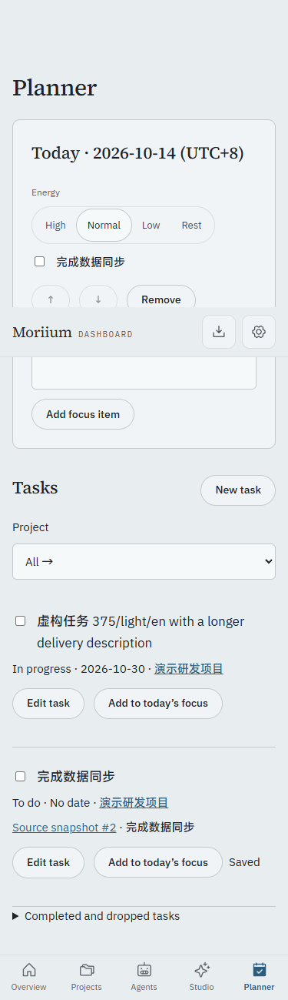
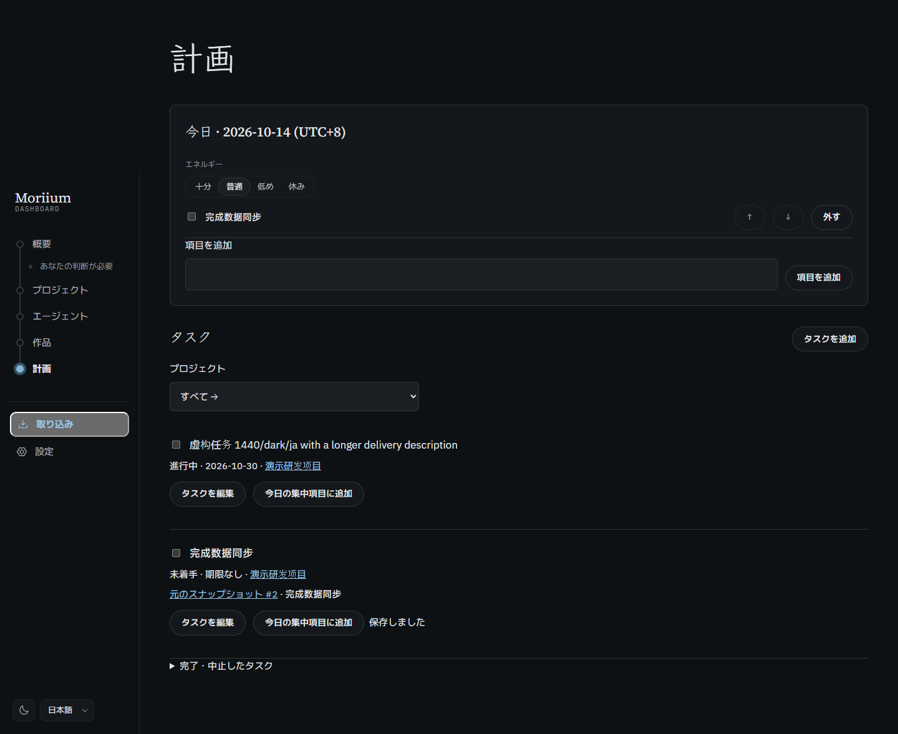

# P5.3 · 任务与快照来源

手动任务有标题、输入语言、项目、截止日期和待办/进行中/完成/放弃状态。由下一步转入的任务在服务端复制原条目，绑定确切快照；来源不可改，仍开放的相同来源不能重复转入。报告中消失只产生提示，不自动完成任务。

- `pnpm verify`：318 个测试、类型和公开树审计通过；当时为 13 个提醒（11 个既有提醒，另两个多余非空断言已在 P5.4 清理）；生产构建通过。
- `node scripts/p5-qa.ts p5-3`：十二组桌面/375px × 浅深 × 中日英，手动创建、来源转入、任务加入焦点、从焦点完成任务、查看确切来源快照、完成后归档，键盘保存与无溢出、CSP、外部请求、减少动画检查。
- 用例覆盖伪造来源标题、重复转入、稳定 ID 改措辞、条目消失、旧窗口冲突、日期、密钥、完成时间、任务与焦点联动及导出。
- 真实鼠标走查发现动作栏的既有页面级负边距遮住来源链接，改为焦点和任务条目内部的正常间距；修正后来源入口可点击。

虚构数据独立临时数据库；正式库未打开，迁移 0009 未在正式数据执行。任务和焦点文字上限扩至协议的 2000 字，转入不会截断。编辑器固定打开时的版本，冲突时保留输入，关闭重开后由用户重新确认。

本工作包不更新阶段快照；一周试用和 v0.1.0 标签待 Morii。
