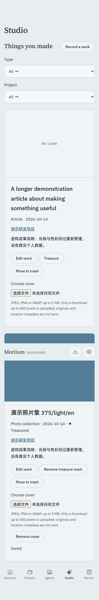
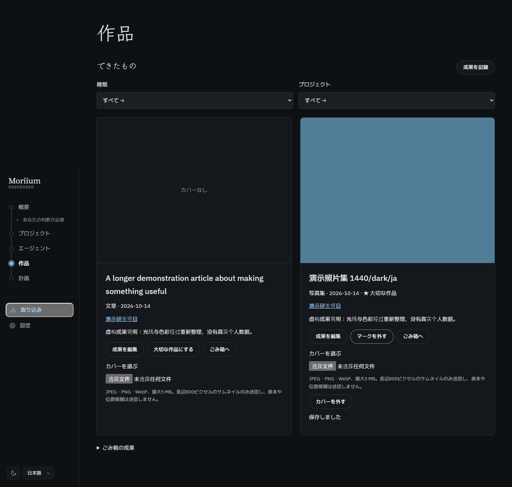

# P5.4 · 成果、封面与最近交付

成果登记支持七种类型、日期、项目、https 链接、说明和珍藏；列表按日期排列，可筛选，删除进入可恢复回收站。作品与封面处理代码按需加载，概览把近 14 天成果和人工验收的里程碑按日期合并，最多六项，并区分来源。项目详情增加成果入口。

- `pnpm verify`：326 个测试、类型与公开树审计通过；11 个既有提醒。
- 生产构建通过：作品代码单独约 2.69 KB gzip，封面处理约 0.93 KB；首屏两份主要 JS 合计约 159 KB gzip，未改变字体基线。
- `node scripts/p5-qa.ts p5-4`：十二组桌面/375px × 浅深 × 中日英；创建、分类、珍藏、封面上传、概览跳转、回收站与恢复；键盘保存、无横向溢出、CSP、无外部请求、减少动画检查。
- 浏览器使用带虚构 EXIF 的 1600×900 JPEG；上传只含重编码并清理的 WebP，私有标记未出现在请求体；取回图片为 800×450。
- 持久化测试使用实际浏览器编码样本，覆盖尺寸/5MB/类型限制、元数据/未知块/尾部/格式别名拒绝、链接和日期、版本冲突、删除恢复、完整导出和 SQLite 在线备份后读取封面。

封面与数据库一起保存，取舍见 [ADR 0004](../adr/0004-work-cover-storage.md)。未打开正式库；迁移 0010 尚未在正式数据执行。本工作包未更新阶段快照，一周试用与版本标签仍待 Morii。

