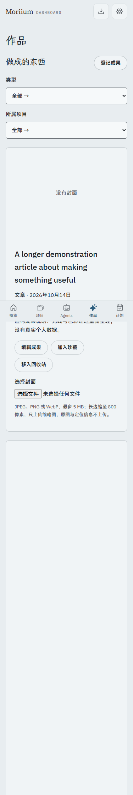
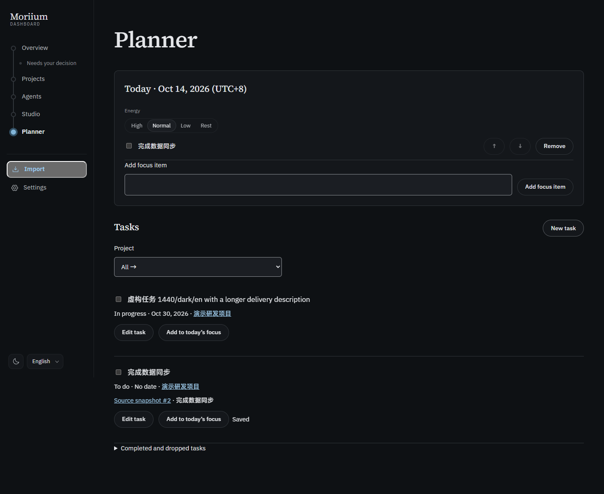

# P5.5 · 界面评审与试用前收尾

按 [Web Interface Guidelines](https://raw.githubusercontent.com/vercel-labs/web-interface-guidelines/main/command.md) 审查 P5 的工作区，同时复核页面导航、表单、国际化、固定导航和运行时隐私。沿用既定 S1 设计，没有新增依赖或风格方案。

## 修正与复核

| 问题 | 处理 | 代码位置 |
| --- | --- | --- |
| 未保存焦点、任务或成果在换页时丢失 | 站内导航、后退、刷新、关闭编辑器、筛选与详情页签切换加原生确认；拒绝后保留草稿。编辑时禁用同条记录的冲突操作 | `router.tsx:14`、`drafts.ts`、`Tasks.tsx:292`、`Works.tsx:399`、`ProjectDetail.tsx:238` |
| 编辑器打开和关闭时键盘位置不明确 | 打开时聚焦图例，不强制唤起手机键盘；关闭后返回入口。控件补 name、label 与相应 autocomplete | `Tasks.tsx:100`、`Works.tsx:101`、`drafts.ts` |
| 窄屏固定导航可能遮挡聚焦元素 | 增加滚动留白，包含底部安全区域；逐步 Tab 检查聚焦元素中心不被覆盖 | `personal.css:243` |
| 仅靠浅边框不易辨认表单 | 使用既有 ink3 token；相对 raised 背景，浅色 5.66:1、深色 5.47:1，达到非文本 3:1 要求 | `personal.css:253` |
| 日期和阶段变化未完全本地化 | 日历日期用 Intl 按选定语言显示，以 UTC 避免纯日期漂移；阶段使用三语枚举文案 | `i18n.tsx:73`、`Agents.tsx:136` |
| 连续新增焦点会使用自身旧版本 | 页面立即采用 PUT 的服务器确认结果；读取追上后采用新读取，包括关联任务状态；版本冲突校验保留 | `Today.tsx:65` |
| 较长个人列表的屏外渲染 | task/work/agent 卡片使用 content-visibility 与预留尺寸；图片保留尺寸与按需加载，封面处理独立加载 | `personal.css:237`、`Works.tsx` |

代码位置相对 `apps/web/src/app/`；`i18n.tsx` 位于 `apps/web/src/i18n/`。原有公开数据来源、密钥检查、CSP、本机访问限制与版本校验没有放宽。

## 实际验证

- `pnpm verify`：17 个测试文件、326 项测试通过；类型检查及公开树审计通过。11 个既有提醒（9 个 CSS 特异性、2 个未使用导入），本工作包未增加提醒。
- `pnpm build`：生产构建通过。
- `node scripts/p5-qa.ts p5-5`：1440px / 375px × 浅 / 深 × 中 / 日 / 英，共十二组全部通过。使用系统临时目录中的虚构独立数据库，结束后清理。
- 每组验证今日三项焦点、排序和完成后的刷新持久化；精力切换；来源任务、手动任务、焦点联动与确切来源；成果创建、珍藏、封面上传、筛选、最近交付入口、回收站与恢复。
- 每组验证草稿的接受 / 拒绝、浏览器后退与刷新、筛选和页签保护、表单标签、键盘保存、关闭后焦点返回及 18 步 Tab 遮挡检查。在减少动画偏好下完成走查；无横向溢出、控制台 / CSP 错误或外部请求。
- 延迟读取探针（`QA_WIDTH=375`、`QA_LOCALE=en`、`QA_SLOW_FOCUS=1`）把焦点 GET 延迟 500ms：修正前连续保存出现自身版本冲突；修正后浅深两组完整流程通过，没有冲突或丢项。该探针与正常十二组使用相同焦点修正代码。
- 人工看过窄屏浅色成果与桌面深色任务截图，确认三语长内容换行、表单边框和来源入口；以下截图只含虚构内容。

## 范围与待验收

这是开发方的本机工程与界面验证，没有打开正式库，没有执行正式数据迁移，不代表一周真实使用或 Morii 验收，也没有完成真实辅助技术用户的完整评测。当前记录仍区分工程证据、报告主张和人工验收。

可选粘贴 JSON、命令面板与 5.6 的个人化细节不影响核心试用，本阶段未加入。列表保留全部个人记录；大规模数据分页和筛选 URL 持久化留后续。P4 的产品验收与 P5 一周试用仍待进行，`v0.1.0` 标签和 P6 部署尚未开始。
