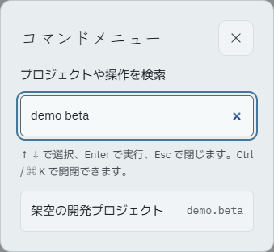
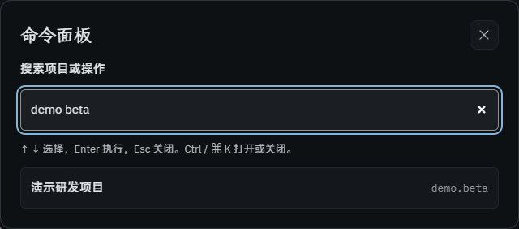

# P5 可选收尾 · 命令面板

侧栏与窄屏顶栏提供命令入口，也可用 Ctrl / ⌘ K 打开或关闭。支持页面和项目跳转、导入、新建任务与登记成果；后两项只打开已有编辑器，不代填或保存数据。

项目搜索匹配登记的中日英名称和 ID，支持多个词、大小写和全角输入。先筛选完整列表，再显示前 50 项，超出时提示继续输入；打开时才读取项目。没有新增依赖、协议字段、后端接口或数据库迁移。

## 验证

- `pnpm verify`：326 项既有测试、类型与公开树审计通过；11 个既有提醒。独立生产构建通过，未改变正在使用的正式前端。
- `node scripts/p5-extras-qa.ts commands`：61 个虚构项目，1440 / 375 × 浅深 × 中日英十二组全部通过，结束后删除临时库。
- 搜索三语别名、ID、全角和多词；可找到初始前 50 项之外的项目；无结果时 Enter 不执行。
- 入口按钮与 Ctrl / Meta K、方向键、14 步 Tab 焦点锁定、Esc 关闭与焦点返回。复现并修正 search 输入框先用 Esc 清空内容的问题。
- 跨页新建及同页再次新建保留已有草稿；项目跳转的拒绝 / 接受经过原有草稿确认；新建编辑器接收焦点。打开带粘贴草稿的导入对话框后，命令快捷键不会抢占它。
- 模拟 `isComposing` 的 Enter 不执行命令；这是浏览器事件回归，未声称覆盖所有真实系统输入法。
- 全程无业务写请求，任务 / 成果 / 快照数量不变；无横向溢出、控制台 / CSP 错误或外部请求。在减少动画偏好下验证；新面板没有新增动画。
- 人工看过窄屏日文浅色与桌面中文深色截图。继续使用既定字体、主题、44px 触控高度、可见焦点与 ink3 搜索框边框；相关颜色沿用已验证 token。

复核：新建意图在用户选择后仅消费一次；导航仍经草稿保护，拒绝导航不打开目标编辑器。查询只在内存中用于筛选，不保存或发送搜索文本；项目文字按 React 文本渲染，项目 ID 编码为站内地址。没有改动真实数据，也不代替 P4/P5 产品验收或一周使用。
