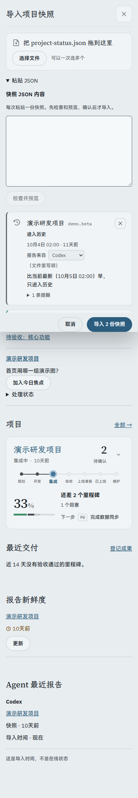
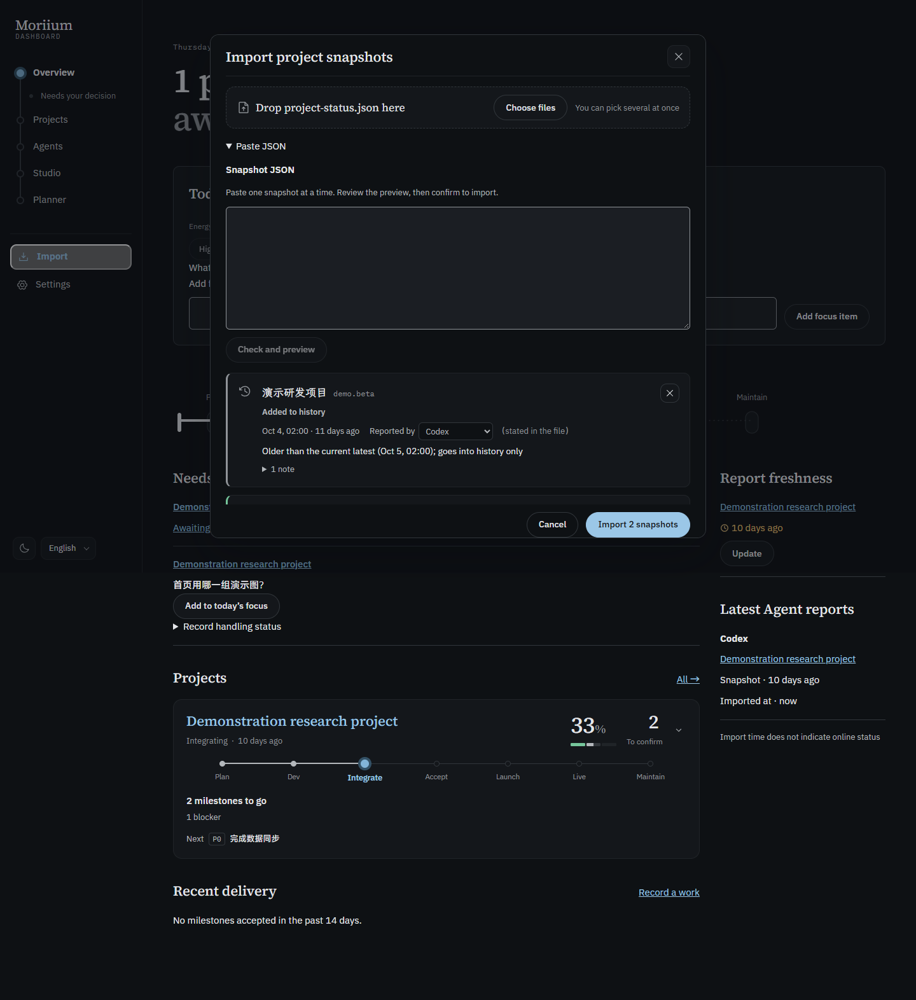

# P5 可选收尾 · 粘贴 JSON

导入对话框增加次要的「粘贴 JSON」入口。一份粘贴内容与文件使用同一套服务端预览、代码块提取选择、项目检查、重复与冲突处理，只有确认后才写入。一次合计最多 20 份，每份按 UTF-8 字节限制 1 MiB；超限时保留输入。未预览的粘贴草稿会阻止误关闭或离开。

不主动读取剪贴板，不在前端解析并重新序列化 JSON。保存字节与文本框实际值一致；文本框 API 会统一换行，因此不承诺保留剪贴板中的 CRLF。文件导入仍保留文件字节。依据：[HTML textarea 的 API value](https://html.spec.whatwg.org/multipage/form-elements.html#the-textarea-element)。

- `pnpm verify`：326 项既有测试、类型与公开树审计通过；11 个既有提醒。
- 生产构建成功；开发验证使用独立 `screenshots/p5-extras-dist`，没有覆盖正在提供的正式前端。
- `node scripts/p5-extras-qa.ts paste`：1440 / 375 × 浅深 × 中日英十二组通过。全部使用新建的临时虚构库，结束后清理。
- 每组检查 Esc 拒绝关闭保留草稿、UTF-8 超限保留内容、非法 JSON、代码块显式提取、文件与粘贴混合预览、预览零写入、确认后两份导入、保存文本字节及重复保护。
- 键盘展开与提交、字段标签、减少动画偏好、无横向溢出、控制台 / CSP 错误和外部请求；人工看过窄屏浅色和桌面深色长预览。

复核重点：服务端校验没有放宽；异步文件读取与预览在关闭后失效，不把旧会话结果带入新会话；读取和写入期间避免重复添加或关闭。未写正式数据或导入真实快照，不代替 Morii 产品验收与一周试用，不进入 P6。
